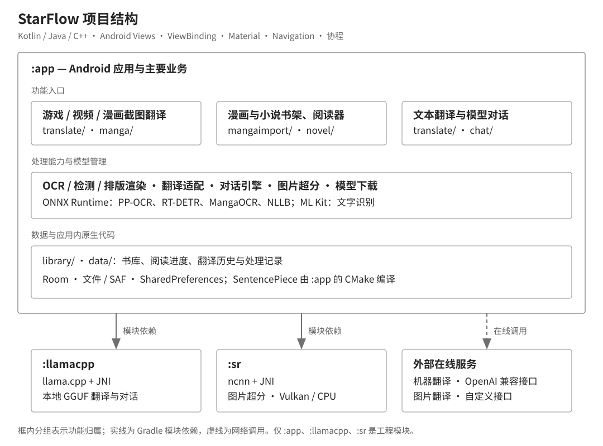

# StarFlow（星译）

StarFlow 是开源 Android 翻译与阅读应用，支持游戏／视频截图翻译、漫画翻译、漫画与小说导入阅读，以及文本翻译和模型对话。

<p align="center">
  
</p>

<p align="center">
  <b>截图翻译 · 漫画与小说阅读 · 本地模型 · 图片超分</b><br>
  免费、无广告 · Android 10+（API 29+）· 仅 arm64-v8a
</p>

## 目录

- [功能概览](#功能概览)
- [下载安装](#下载安装)
- [使用指南](#使用指南)
- [导入功能和阅读器](#导入功能和阅读器)
- [模型与翻译引擎](#模型与翻译引擎)
- [项目结构](#项目结构)
- [项目构建](#项目构建)
- [致谢](#致谢)
- [许可证](#许可证)

## 功能概览

| 场景 | 输入 | 主要能力 |
|---|---|---|
| 游戏／视频翻译 | 当前屏幕或框选区域 | 悬浮结果框、画面变化检测、自动翻译、最近多条译文 |
| 漫画截图翻译 | 屏幕上的漫画页 | 气泡检测、日文竖排 OCR、横／竖排覆盖渲染、翻页后自动翻译 |
| 漫画书架与阅读器 | 图片目录、ZIP／CBZ、RAR／CBR、7z、PDF | 章节导航、多种阅读模式、单页／整章翻译、超分、图片与 PDF 导出 |
| 小说书架与阅读器 | TXT、EPUB、HTML、ZIP-HTML、作品文件夹 | 章节与分页、段落／插图翻译、向后预翻、原文／译文／双语 TXT 导出 |
| 图片翻译 | 截图、漫画页或小说插图 | 直传百度/腾讯云/自定义图片接口，不跑本地 OCR；有坐标回画原图，无坐标显示文本 |
| 文本翻译与对话 | 输入文本 | 翻译记录、复制、流式输出；通过本地 GGUF 或 OpenAI 兼容接口进行多轮对话 |

阅读器直接处理导入文件，无需截屏权限；文本翻译支持直接输入或粘贴文字。

应用本身免费，在线服务的费用与额度由供应商决定。选择本地 OCR 与本地翻译模型后，识别和翻译可离线完成。

## 下载安装

| 方式 | 链接 |
|---|---|
| GitHub Releases | [下载最新发布版](https://github.com/xujunjiex/StarFlow/releases/latest) |
| 百度网盘 | [下载安装包](https://pan.baidu.com/s/1Zi-o2mHhgJEqhk8UzxRoSA?pwd=star) |
| 夸克网盘 | [下载安装包](https://pan.quark.cn/s/cbac92882d82?pwd=E9P8) |

设备需运行 Android 10 及以上，并支持 64 位 ARM。默认 PP-OCRv6 small 已内置，其他 OCR、本地翻译和超分模型可在模型管理页按需下载。

首次使用建议：

1. 选择源语言、目标语言和翻译引擎；使用需要凭据的在线服务时填写相应配置。
2. 根据需要在模型管理页下载其他模型，或导入 llama.cpp 兼容的 GGUF。
3. 截图翻译按提示授予截屏、悬浮窗等权限；文件阅读从导入页选择漫画或小说。

应用内可检查版本更新、查看公告与常见问题。

## 使用指南

### 翻译执行模式

设置页的「翻译模式」提供三种执行方式：

- **文本翻译**（默认）：本地 OCR 识别文字，再交给文本翻译引擎；文本翻译页与小说正文始终使用这条链路。
- **仅 OCR**：只识别并显示/保存原文，不调用翻译。
- **图片翻译**：截图或阅读器图片直接上传到云端图片翻译接口，**不经过本地 OCR**。百度、腾讯云与自定义图片接口都可用；接口返回文字坐标时会把译文画回原图，只返回文本时使用文本结果窗口/弹窗。文本翻译、仅 OCR 和小说正文不受影响。

图片翻译需要先在 API 配置中启用并填写对应接口；切换执行模式前请停止正在进行的 OCR 或翻译任务。

### 游戏与视频翻译

<p align="center">
  
  
</p>

从翻译页启动悬浮球，可手动翻译全屏或框选区域，也可开启自动翻译。识别后的文字交给所选引擎，译文显示在可拖动的结果框中。

- 悬浮球的单击、双击、长按可配置为翻译、打开菜单、切换自动翻译或关闭悬浮窗；外观、大小与透明度可调整。
- 结果框支持锁定、复制、重新翻译和关闭，可配置字体、字号、颜色、背景及原文对照。
- 可同时显示最近 1–5 条译文；多条模式只显示译文，不拼接原文。
- 游戏对话可等待画面稳定后再识别；视频字幕可关闭稳定性检测，在画面变化时触发翻译。
- 分屏使用时，可关闭游戏画面上的结果浮窗，通过主窗口历史页查看文本翻译记录。

**翻译前 / 后处理脚本**

- 用 JavaScript 在**原文送进翻译引擎之前**与**译文返回之后**各处理一次，两段脚本分别设置；默认关闭
- 脚本是函数体，入参是字符串 `s`，用 `return` 交出结果。预置模板就是「什么都不做」：`return s;`
- 内置模板：不做处理 / 去掉换行并合并空格 / 去掉所有空白字符 / 半角标点转全角
- 脚本报错、语法不合法或执行超时，都自动**按原文返回**，不会让翻译失败；脚本也读不到应用内部的对象
- 保存前会做语法检查，语法不通过时会提示并让你继续修改
- ⚠️ 目前只对**游戏/视频的文本翻译**生效；漫画气泡、小说与图片翻译不走这条路径
- ⚠️ 译文脚本的结果会写进历史与缓存，改完脚本后已翻过的画面仍显示旧结果

截图来源由游戏与漫画共用：默认使用 MediaProjection，需要系统录屏授权；也可手动开启无障碍截图服务。无障碍截图依赖系统接口，Android 10 请使用 MediaProjection。

平板上的启动页、首次引导和主页跟随系统方向，手机保持竖屏。Android 14 及以上请求整屏录屏授权，翻译区域通过悬浮菜单框选。

### 漫画截图翻译

漫画模式将检测到的文字／气泡区域识别、翻译并回填到页面上，支持译文覆盖、原文覆盖与纯原图切换，点击气泡可复制文字。 屏幕方向、分辨率或显示密度变化后，会收起旧译文并取消在途翻译；结果位置无法校验时不显示，需重新截图。截图缓存只有在原图像素完全一致时才复用旧位置，否则重新识别并继续使用文本译文缓存。

自动翻译检测到页面变化并停稳后处理当前页，不负责替外部阅读应用执行翻页。PP-OCR 可合并同一句话的多行或多列；表格、多栏页面可关闭区域合并。

支持分批显示识别与翻译结果，以及横排、竖排、字体、颜色和字号设置。

自动字号会结合文字区域、全文长度和字距／行距，选择区域内能容纳全文的最大字号；固定字号按所选数值显示。

字间距和行／列间距默认均为字号的 20%；行／列步距在 20% 时为 1.2 倍字号，0% 时为 1.0 倍，不叠加固定间距。旧版默认的 0% 首次升级为 20%，之后主动设置的 0% 会保留。

个性化顶部依次为「游戏/视频配置」「通用配置」「漫画配置」，默认打开中间的通用配置，包含悬浮球、AI 上下文、翻译通知和其他设置。游戏/视频配置集中管理翻译结果、分屏、自动翻译和文本前/后处理脚本；漫画配置包含漫画翻译结果设置。超分模型在模型管理页选择，阅读器内的「超分模型」入口也可直达。

个性化 → 漫画配置 → 漫画翻译结果设置底部提供「PP 异常选区尺寸过滤」，默认关闭。开启后可分别调整过小、过大选区的容差，数值越小过滤越严格。PP-OCRv5/v6 的截屏和导入漫画翻译共用整页统计，在识别与合并前过滤；不足 5 个有效框时跳过相对尺寸过滤。已识别或已翻译页面需重新识别，标题和小注释也可能被过滤，可在 PP 调试视图检查丢弃原因。

<p align="center">
  
  
</p>

### 截屏翻译历史记录

历史页包含游戏和漫画两种截屏翻译记录：

- **游戏历史**：查看游戏／视频截图识别的原文与译文，支持复制、紧凑显示和 TXT 导出。
- **漫画历史**：查看漫画截图的原图与翻译结果，支持翻页浏览、重新翻译和导出。

关于页 → 查看日志 → 导出，可将当前日志保存到下载目录下的 `StarFlow/`。导出失败时，完整原因会显示在日志中，可长按选择或使用复制按钮获取。

<p align="center">
  
  
</p>

### 文本与对话翻译

文本页直接翻译输入内容，支持译文复制、历史记录和所选引擎提供的流式输出。源语言不受 OCR 组合限制，目标语言依翻译引擎支持范围选择。

对话 Tab 支持聊天模板、消息历史与多轮对话，使用本地 GGUF 或 OpenAI 兼容接口；本地模型准备完成后可离线对话。

## 导入功能和阅读器

批量导入时，漫画和小说合计最多同时处理两个任务，其余显示“等待导入”；正在执行和等待中的任务均可取消。扫描与删除按顺序执行，避免批量操作相互干扰。

在导入页切换漫画与小说书架，导入本地作品后即可阅读、翻译和导出。

### 漫画书架与阅读器

在导入页选择漫画文件或整个目录，也可将文件放入当前书库的 `manga_import/` 后扫描。压缩包和 PDF 保留原格式并按需读取，目录内可混合图片、子章节、PDF 和漫画压缩包，按名称自然排序。

| 能力 | 说明 |
|---|---|
| 书架管理 | 列表／网格、封面、简介、重命名、已读标记、多选删除、刷新与扫描 |
| 阅读方式 | 左到右、右到左、竖向整页、连续滚动（Webtoon） |
| 阅读外观 | 翻页动画、背景、亮度与对比度、反色／灰度／书本效果 |
| 导航 | 章节目录、章内进度与切章提示、缩略图跳页与定时自动翻页 |
| 页面翻译 | 手动翻译、跟随当前页自动翻译、向后预翻；查看失败原因并重试 |
| 章节任务 | 翻译本章、暂停／继续／取消、等待与执行进度 |
| 显示与导出 | 原图／原文覆盖／译文切换，原文／译文／双语导出，可优先使用已保存的超分图 |

漫画页直接对原文件识别，避免屏幕截图缩放影响。已翻译页面可调整字体、颜色和排版，无需重新翻译。

漫画和小说阅读器的翻译按钮在手动空闲时单击翻当前页或一批、双击开启自动翻译；前台翻译运行时单击查看提示、双击结束并回到手动。长按按钮可在上方直接选择手动、自动或增量模式，选择后快捷菜单自动关闭。小说选段模式下，空闲单击直接翻译选中段落。

同一本漫画或小说的多个“翻译本章”任务按提交顺序排队，上一章的在途任务全部结束后才启动下一章。暂停后保留待翻内容，待在途请求结束后处理下一章；继续时排队等待，不抢占当前章节。章内仍按“最大同时请求数”处理页面或批次。

图片来源导出 ZIP，保留原页序与目录；译文 ZIP 可选择是否包含未译页，双语包中的未译页只保留原图。PDF 来源导出 PDF。开启“优先导出超分图”后使用可用超分产物，无产物的页面保留原图。

### 小说书架与阅读器

小说入口与漫画书架位于同一导入页，支持以下来源：

- TXT、EPUB、HTML／HTM／XHTML，以及包含 HTML 或 TXT 章节的 ZIP。
- 作品文件夹，可在最多 6 层子目录中组织 TXT、HTML、EPUB 与 ZIP 小说卷。
- 内容嗅探和 UTF-8／GBK／Big5 等编码识别，可处理部分扩展名缺失或不规范的文件。

带外部插图的 HTML 应按整本文件夹导入，图片相对引用需位于作品目录内。MOBI／AZW、FB2、PDF 与 RAR／7z 小说包不属于当前小说解析器的支持格式。

阅读器支持左右翻页、上下翻页和连续滚动，可调节字体、字号、行距、段距、背景与状态颜色。EPUB 原文字号可按设置读取，原文、译文与双语显示分别排版。

支持手动翻译、当前页自动翻译、向后预翻和整章翻译，也可识别并翻译书中插图。

整本可导出原文、译文或双语 TXT 到系统 Download，未翻译的段落回填原文。TXT 导出不保留 EPUB 的图片和原排版。

### 图片超分

漫画阅读器支持单页和整章超分。模型权重按需下载，当前提供 **11 个 2x 模型**：Real-CUGAN SE／Pro／Nose、Waifu2x CUNet／Fast、Real-ESRGAN、Waifu2xEX Universal Fast／Omni Mini v2／Photo Small、sudo UltraCompact、SPAN NomosUni。

同一本漫画的多个“超分本章”任务按提交顺序排队，章节及章内页面都串行处理。等待章节显示“等待”，可单独取消；取消当前章会等正在处理的页面停止后再启动下一章。章节翻译和超分均支持系统通知栏进度，锁屏、切换应用或退出阅读器后继续；超分可从通知栏取消，点通知返回对应章节。任务执行期间使用前台服务与 CPU 唤醒锁，全部暂停且在途请求结束后释放唤醒锁，结束后停止服务。系统强制停止、省电与网络限制仍可能中断任务。

章节任务只有一章时显示一条进度通知；多章排队时最多显示“总任务进度”和“当前章节进度”两条，总进度保留已结束章节。翻译、超分与模型下载复用同一任务进度通知通道，锁屏显示沿用系统对星译的应用通知设置，不另设应用内锁屏开关。首次缺少通知权限时申请系统授权；允许通知及锁屏显示后即可查看进度。模型下载使用前台服务和 CPU 唤醒锁，息屏后继续；系统省电与网络限制仍可能影响长时间任务。

超分由 ncnn 执行，支持 Vulkan；部分模型可在没有 Vulkan 时使用 CPU，Real-ESRGAN 需要 Vulkan。可根据设备性能调整输入尺寸、分块与精度，并选择优先导出超分图。

页面翻译可设置自动超分，也可单独执行整章超分。另提供 Anime4K 阅读显示增强。

### 书库结构

漫画与小说支持自定义书库目录、封面与简介、阅读进度和作品记录查看。书库位置可通过系统文件选择器设置，作品来源分别放在 `manga_import/` 和 `novel_import/` 中。

```text
书库根目录/
├── manga_import/             漫画来源
├── novel_import/             小说来源
└── .starflow/
    ├── library.json          书库身份
    ├── storage.json          存储方式标记
    └── books/<UUID>/         来源索引、封面和图片产物等
```

清除应用数据或卸载前，请导出需要保留的内容并备份原书。

## 模型与翻译引擎

### OCR 引擎

在模型管理页选择 OCR 引擎，并按需要下载识别模型。

| 引擎组 | 漫画路径 | 游戏／视频路径 | 模型准备 |
|---|---|---|---|
| PP-OCRv6（默认） | 检测、识别与区域合并 | PP-OCRv6 | small 已内置，medium 可下载 |
| PP-OCRv5 | 检测、识别与区域合并 | PP-OCRv5 | 下载检测和所需语言识别模型 |
| RT-DETR-V2 + MangaOCR | 气泡检测与日文识别 | 使用 ML Kit | 漫画路径需下载两组模型 |
| ML Kit | 文字识别与气泡合并 | ML Kit | 已随应用集成 |

语言支持随引擎组变化。PP-OCRv5 提供中日英混合与英／韩／俄专用识别模型；RT-MANGA 的漫画路径面向日文。模型下载支持断点续传、重试与校验。

### 翻译引擎

| 类别 | 可选引擎 | 说明 |
|---|---|---|
| 本地 GGUF | LlamaCpp | 可下载预制 Hy-MT2 1.8B 的 1.25-bit／Q4_K_M 档，也可导入 llama.cpp 兼容 GGUF；支持模型模板、提示词、采样与线程参数 |
| 本地机器翻译 | NLLB | 模型下载后可离线运行，较大模型需要足够可用内存 |
| 在线机器翻译 | 必应、小牛、火山、Azure、DeepL、百度、腾讯 | 按供应商要求配置凭据；可用性、额度与价格以服务方为准 |
| 在线模型 | OpenAI 兼容接口 | 内置 DeepSeek、通义千问、豆包、智谱等配置，支持自定义地址、Key、模型与模型列表获取 |
| 自定义接口 | 文本与图片接口 | 按接口配置请求和结果解析 |

图片直传另支持百度、腾讯与自定义接口，由服务方处理图片，不经过本地 OCR。游戏／文本与漫画可使用独立的 AI 提示词；多气泡可合并为编号请求，部分引擎支持上下文与思考模式配置。

使用在线文本接口时，识别文本会发送到所选服务；图片直传会发送图片。使用本地 OCR 和本地翻译时，识别与翻译在设备上完成，模型下载和更新检查仍需要网络。

## 项目结构

StarFlow 使用 Kotlin／Java 与 C++ 开发，界面采用 Android Views、ViewBinding、Material 和 Navigation，异步处理使用 Kotlin 协程，数据存储使用 Room。本地推理集成 ONNX Runtime、ML Kit、llama.cpp 与 ncnn。



结构图文件：[images/project-architecture.svg](images/project-architecture.svg)。主要业务位于 `:app`，实线表示 Gradle 模块依赖，虚线表示在线服务调用。

| Gradle 模块 | 职责 |
|---|---|
| `:app` | 应用界面、截图翻译、漫画与小说阅读、模型管理和数据存储 |
| `:llamacpp` | llama.cpp 本地大模型推理与 JNI 桥接 |
| `:sr` | 基于 ncnn 的图片超分与 JNI 桥接 |

主要业务源码位于 `app/src/main/java/`：

| 路径 | 功能 |
|---|---|
| `com/moe/starflow/translate/` | 截图服务与文本翻译 |
| `com/moe/starflow/manga/` | 漫画检测、OCR、翻译与排版渲染 |
| `com/moe/starflow/mangaimport/` | 漫画导入、书架与阅读器 |
| `com/moe/starflow/novel/` | 小说解析、阅读、翻译与导出 |
| `com/moe/starflow/library/`、`com/moe/starflow/data/` | 书库、数据存储与翻译历史 |
| `com/moe/starflow/download/` | 模型管理与下载 |
| `com/moe/starflow/llamacpp/`、`com/moe/starflow/sr/` | 本地模型适配与图片超分 |
| `com/moe/starflow/chat/`、`com/moe/starflow/ui/` | 模型对话与共享界面 |
| `translationapi/` | 翻译引擎接口与服务商适配 |

## 项目构建

| 项目 | 要求 |
|---|---|
| JDK | 17 |
| Gradle／AGP／Kotlin | Wrapper 8.10.2／8.6.0／1.9.22 |
| Android SDK | compileSdk／targetSdk 35，minSdk 29 |
| NDK／CMake | 25.2.9519653／3.22.1 |
| 运行架构 | arm64-v8a |

克隆仓库后，使用 Android Studio 打开项目，在 SDK Manager 中安装上述 SDK、NDK 和 CMake，并在 `local.properties` 中配置 `sdk.dir`。

在项目根目录使用 PowerShell 7 初始化原生依赖，再通过 Gradle Wrapper 构建：

```powershell
pwsh -File llamacpp/setup-submodule.ps1
pwsh -File sr/setup-ncnn.ps1
.\gradlew.bat :app:assembleDebug
```

llama.cpp 使用项目脚本准备固定版本源码，请勿先执行 `git submodule update`。

Debug APK 输出到 `app/build/outputs/apk/debug/app-debug.apk`。构建 Release APK 使用：

```powershell
.\gradlew.bat :app:assembleRelease
```

## 致谢

本项目基于 [MoeTranslate](https://github.com/murangogo/MoeTranslate)，并使用或参考了以下项目：

- [RapidOCR](https://github.com/RapidAI/RapidOCR)、[RT-DETR](https://github.com/lyuwenyu/RT-DETR)、[manga-ocr](https://github.com/kha-white/manga-ocr)：文字与气泡识别。
- [manga-image-translator](https://github.com/zyddnys/manga-image-translator)、[Kototoro](https://github.com/Kototoro-app/Kototoro)：漫画翻译与阅读交互。
- [llama.cpp](https://github.com/ggml-org/llama.cpp)、[ONNX Runtime](https://onnxruntime.ai/)、[SentencePiece](https://github.com/google/sentencepiece)：本地推理与分词。
- [ncnn](https://github.com/Tencent/ncnn)、[waifu2x-ncnn-vulkan](https://github.com/nihui/waifu2x-ncnn-vulkan)、[realcugan-ncnn-vulkan](https://github.com/nihui/realcugan-ncnn-vulkan)、[Anime4K](https://github.com/bloc97/Anime4K)：超分与显示处理。
- [pixelmatch](https://github.com/mapbox/pixelmatch)、[JTS](https://locationtech.github.io/jts/)：像素比较与几何处理。

## 许可证

项目许可证见 [LICENSE](LICENSE)（GNU LGPL v3）。第三方声明见 [licenses/NOTICE.txt](licenses/NOTICE.txt)，其他许可证文本位于 [licenses/](licenses/)；依赖与模型各自的授权以其来源为准。
